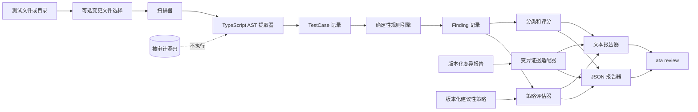

<a href="../architecture.md">English</a> · <strong>简体中文</strong>

# 架构设计

## 设计约束

- 解析源码但绝不执行。
- 框架识别/提取与规则评估分离。
- 发现项是不可变、具公开 JSON 形状的数据。
- 将来的语义、变异、diff、CI 适配器不能悄悄改变确定性输出。

## 运行流程

## 组件

| 组件                  | 职责                                                                                                                                       | 边界                                                                                   |
| --------------------- | ------------------------------------------------------------------------------------------------------------------------------------------ | -------------------------------------------------------------------------------------- |
| `scanner`             | 发现支持的测试文件名，跳过依赖和产物目录。                                                                                                 | 不解析、不执行源码。                                                                   |
| `extractor`           | 用 TypeScript AST 提取框架测试注册及源码位置。                                                                                             | 不解析模块依赖，不执行回调。                                                           |
| `callback-resolution` | 解析作为测试回调传入的同文件函数声明和直接初始化为函数的变量。                                                                             | 不跟踪导入、任意别名；会排除被遮蔽或存在静态写入的绑定。                               |
| `scope-analysis`      | 排除块和 namespace 中静态可见的遮蔽、重赋值、解构写入和文件级 `var` 绑定。                                                                 | 不构建 TypeScript 类型或符号图。                                                       |
| `rules/ast-traversal` | 遍历回调、静态可达的同文件 helper 链，以及有边界的 Promise、Array 字面量、polling、Playwright `toPass` 和 `fast-check` property callback。 | 跳过未调用函数；将不透明 callback 记录为不确定证据而不推断其已执行，并隔离各测试回调。 |
| `rules/*`             | 对单一 `TestCase` 生成确定性发现项。                                                                                                       | 不推断产品意图。                                                                       |
| `audit`               | 聚合规则、单测分类、FTR 和分数。                                                                                                           | 不生成 `STRONG`。                                                                      |
| `changed-files`       | 从已验证的本地提交选择当前变更的测试文件。                                                                                                 | 不拉取、不执行源码、不推断测试关联性。                                                 |
| `mutation`            | 校验显式 opt-in 的版本化变异产物并推导阈值状态。                                                                                           | 不运行变异命令，不改变静态审计语义。                                                   |
| `policy`              | 校验显式 opt-in 的建议性策略，并统计其禁用规则 ID 选择的发现项。                                                                           | 不移除发现项，不改变分类/汇总/退出码，不创建 CI 门禁或发布决定。                       |
| `baseline`            | 校验显式 opt-in 的版本化基线，并统计稳定身份属于历史项的本次发现项。                                                                       | 不接受、移除、改变或压制发现项、分数、策略计数或退出语义。                             |
| `decision`            | 校验版本化静态快照并投影建议性决策。                                                                                                       | 不执行源码、不消费 semantic/mutation 证据、不创建 CI 门禁，也不改变 `review`。         |
| `gate-policy`         | 校验显式 `mode: "gate"` 与 `blockOn: ["FAKE"]` 策略。                                                                                      | 不改变 advisory 策略行为。                                                             |
| `gate`                | 从已校验静态快照生成紧凑 `GateResult`。                                                                                                    | 仅 FAKE 门禁；WEAK 永不阻断。                                                          |
| `reporters`           | 将同一结果渲染为文本或 JSON。                                                                                                              | 不添加发现项。                                                                         |
| `cli`                 | 解析命令、校验输入、输出报告、选择退出码。                                                                                                 | 除退出码语义外不设发布策略。                                                           |

`BenchmarkManifest` 是 `ata benchmark` 使用的 version `1` 纯源码契约。runner 解析相对于 manifest 的 fixture 路径，调用现有静态 `auditPath` 管线，比对精确的 rule/classification 身份与明确的 non-triggers，不 import 或执行 fixture 源码。`renderText` 接受 `en` 或 `zh-CN`；`renderJson` 保持现有结构化 schema。

`--policy <path>` 为纯源码审计提供建议性策略。无效策略输入返回退出码 `2`。策略评估器只报告禁用/活跃选择计数；它不能移除发现项、创建 CI 门禁或作出发布决定。

`ata decision <envelope>` 是建议性决策适配器：有效调用返回 `0`；无效信封返回 `2`，且不输出部分决策。

`audit-reference.yml` 在调用 `decision` 前，将 changed-since 审计 JSON 投影到严格的 `DecisionEnvelope` 白名单；审计专用元数据不会透传。

## 数据契约

`TestCase` 保留名称、文件、框架、类型、起始行、回调源码和函数体；内部分析上下文还保留完整源文件与回调起始位置，并在公开审计结果中剥离。含插值的模板名称保留为源码文本；每个注册调用点只提取一次，不求值循环值。提取器接受未被遮蔽的全局 `test`/`it` 调用，也接受从受支持框架模块静态导入的 test 别名，包括各框架适用的 `.skip`、`.only`、`.concurrent`、`.failing` / `.fails`、Playwright `.fail` / `.fixme`、`.each`、`.skipIf` 和 `.runIf` 注册形式。回调解析接受同一文件中的函数声明和直接初始化为函数的变量；导入函数、任意别名、被遮蔽的名称或存在静态写入的绑定不会解析，也不会追踪任意测试 wrapper。提取器也可以携带静态识别的 matcher binding：从 `@jest/globals`、`vitest` 或 `@playwright/test` 导入的具名 `expect`，或通过 `@jest/globals`、`vitest` 或 `@playwright/test` 的字面量 CommonJS 解构取得的别名。matcher 分析支持 `.not`、`.resolves`、`.rejects` 链，以及 Vitest/Playwright 的 `expect.soft` 和 `expect.poll`；只有表达式体或单一 return 的 polling 结果会被解开。规则遍历识别 `expect.poll` 和 Playwright `expect(callback).toPass()` callback、能从直接 Array 字面量确认至少迭代一次的部分方法、运行次数可静态确认为正数的默认/namespace `fast-check` `fc.assert(fc.property(..., callback))` 形式，以及仅在 primitive `Promise.resolve` / `Promise.reject` 链被测试回调 await 或 return 时识别 Promise callback。断言若只位于不透明 callback、条件调用的本地 helper callback 中，或来自断言式名称的导入 helper 调用，会将 UT001/E2E001 降为 `WEAK`；不会据此认定 callback 已执行，也不会检查导入 helper 的实现。不会推断 `sort` / `toSorted` 会调用比较器。源码中可见的局部遮蔽和被重新赋值的 CommonJS 别名会排除。Jest、Vitest 与 Node 测试还可以保留从 ESM value import 或字面量 CommonJS `require()` 调用静态声明的 `node:assert` value binding，包括从 `node:assert` 命名导入的 `strict`。比较断言和单参数 `assert` / `assert.ok` 会参与既有 Unit 与 API 规则。源码中可静态识别的未绑定名称、遮蔽、重赋值或直接替换 namespace 方法不会被识别为原生断言；分析器不解析模块或执行源码。`Finding` 保留稳定 ID、分类、严重性、置信度、位置、信息和修复建议。可选 `MutationReport` 保留引擎标识、已记录命令、阈值及来源、数量、分数和推导出的阈值状态。可选 `PolicyEvaluation` 保留建议性策略标识、禁用规则 ID 和禁用/活跃发现项计数。`AuditResult` 是唯一报告输入与 JSON 输出。

matcher binding 是规则分析的内部元数据。`expectBindings` 不会进入 `AuditResult` JSON 和 version 1 `DecisionEnvelope`；`node:test` 不假定存在未绑定的全局 `expect`。namespace module block 纳入词法遮蔽检查。Promise 链在已知 settlement 使选中 callback 不会执行、handler 省略、返回基本字面量或 `finally` handler 结果为空时保留已知状态；同作用域 helper 链只在调用早于可见绑定写入时跟踪。

## 评分

`assessed = FAKE + WEAK + INVALID`；当 assessed 非零时，`FTR = fake / assessed × 100`；`Trust Score = max(0, 100 - critical × 25 - warning × 10)`。该模型统计发现项，不统计测试执行或缺陷发现能力。

## 扩展

未来可增加语义评审、变异证据和 CI 注释适配器，但必须分别披露证据来源；未经明确、单独文档化的证据，不得把确定性 `UNASSESSED` 升级为 `STRONG`。
